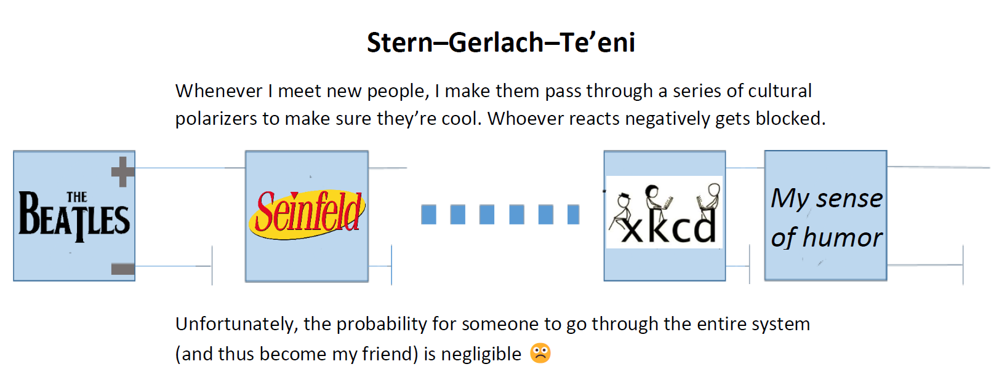

[← Back to Main Page](/)

---

# Jokes & Fun

This is the collection of my social media posts, thoughts, and writings from over the years.

## Hebrew (ניב מקומי)

<ul>
  
  
    
      <li>
        <a href="{{ joke.url | relative_url }}">{{ joke.title }}</a>
        - {{ joke.date | date: "%d.%m.%Y" }}
      </li>
    
  
</ul>

## English (Nonlocal Dialect)

<ul>
  
    
      <li>
        <a href="{{ joke.url | relative_url }}">{{ joke.title }}</a>
        - {{ joke.date | date: "%d.%m.%Y" }}
      </li>
    
  
</ul>
