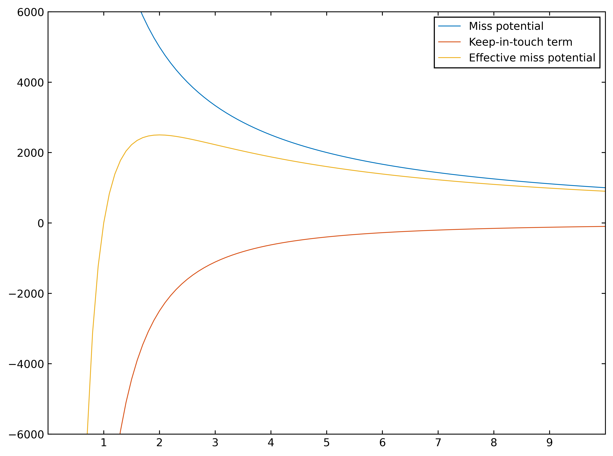

  כשאדם עוזב את הסביבה הרגילה והמוכרת שלו לתקופה ממושכת, אפשר לצפות שהוא יתגעגע הכי הרבה לאנשים הכי קרובים אליו. אבל *מכניקה פסיכואנליטית* מלמדת אותנו שלא כך הדבר. אמנם פוטנציאל הכבידה הנפשית של הגעגוע פרופורציוני ל-$1/r$ (כאשר r הוא מספר חיובי המייצג את המרחק החברתי-רגשי הבין-אישי), אך איבר התנע הזוויתי (המניע חברים להמשיך להסתובב יחד מדי פעם) פרופורציוני ל$-1/r^2$. פוטנציאל הגעגוע האפקטיבי הוא הסכום של שתי התרומות הללו, והוא מוצג בגרף הבא:
  
  אז אם מישהו אומר לך "אני אתגעגע אלייך הכי הרבה", המרחק ביניכם הוא בערך 2.

